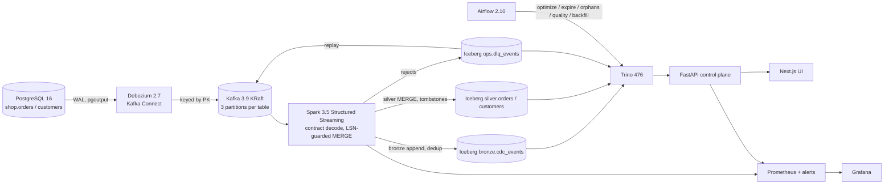

# LakeFlow: CDC lakehouse with verifiable delivery semantics

**LakeFlow streams every change in a PostgreSQL database into an Apache Iceberg lakehouse within seconds.**
Duplicates, retries, crashes, late events and schema drift must not corrupt the result. The project also
ships the tests, benchmarks and UI that check that claim. The path is PostgreSQL → Debezium → Kafka → Spark
Structured Streaming → Iceberg on MinIO → Trino. Around it sit a FastAPI + Next.js control plane, Airflow
maintenance and Prometheus/Grafana.

**What it is:** a learning and portfolio project. It implements change data capture end to end on one machine
and makes the delivery guarantees testable. **What it is not:** a production deployment. The main limitations
are:

- It is single-node: Spark `local[2]`, one Kafka broker and one MinIO node.
- There is no TLS or SSO.
- Delivery is at least once, with an *effectively-once outcome*. Writes are not one transaction across tables.
- Backfill is experimental.
- Benchmark numbers come from shared CI runners.

Details are in [Limitations](#limitations) and the [evidence index](#evidence-index).

[](https://github.com/Charanloyal/lakeflow/actions/workflows/ci.yml)

**Demo: https://lakeflow-demo.onrender.com/lakeflow/** (a recording of a real CI end-to-end run, [details](#demo))

## Demo

| | |
|---|---|
| **Recorded demo (no install):** https://lakeflow-demo.onrender.com/lakeflow/ (also on GitHub Pages: https://charanloyal.github.io/lakeflow/) | The real UI, showing API responses captured from the real stack during the CI end-to-end run. It is read-only and says so on every page. The banner shows the commit, the CI run and the capture time with its age. Health, lag and freshness are the values at capture time, not the current state. Before publishing, CI checks the recording for provenance, secrets and unmasked PII ([`scripts/check_recorded_demo.py`](scripts/check_recorded_demo.py)). The Render free plan (512 MB) cannot run Kafka, Spark and Trino, so Render runs an nginx proxy of the GitHub Pages build ([`render.yaml`](render.yaml)). CI rebuilds that build from `main` after the full-stack job passes. The Render deploy therefore does not change when a new recording is published. Its free instance sleeps when idle, so the first load can take about a minute. |
| **Live stack in your browser:** [](https://codespaces.new/Charanloyal/lakeflow?quickstart=1) | A 4-core/16 GB Codespace starts the full stack automatically (about 8 minutes on first boot) and opens the UI. Log in with `admin` / `local-only-admin`. |
| **Locally:** see the [5-minute quick start](#5-minute-quick-start) | Docker only. |


## Architecture



- **Catalog.** An Iceberg REST catalog backed by PostgreSQL. Spark writes and Trino reads through the same catalog.
  There is no second source of truth.
- **Contracts.** [`contracts/`](contracts/) holds the contracts: JSON Schema 2020-12 plus lakehouse metadata
  (primary key, target table, PII policy, freshness SLA). The single decoder in
  [`libs/lakeflow_core`](libs/lakeflow_core/) validates every event, and Spark, the API and the tests all use that
  decoder.

## 5-minute quick start

Requirements: Docker with at least 6 GB of memory (`8gb` profile) or 11 GB (`16gb` profile, which adds Airflow,
Prometheus and Grafana).

```bash
make bootstrap PROFILE=8gb   # generates .env secrets, pulls/builds images
make up PROFILE=8gb          # waits until every service is healthy, prints URLs
make demo                    # insert -> update -> crash Spark -> delete, with real LSNs, offsets, snapshot ids
```

Open http://localhost:8080 and log in as `admin` / `local-only-admin`. Every port binds to 127.0.0.1.
Without `make` (for example on Windows), use `python scripts/lakeflowctl.py <command>`.
`make test`, `make integration-test`, `make benchmark`, `make maintenance` and `make down` do what their names
say.

## Walkthrough (what to click)

1. **Overview → Guided demo.** It inserts, updates and deletes an order. The trace timeline shows each hop with
   its real identifier: PostgreSQL txid and LSN, Kafka partition and offset, Spark batch id, Iceberg snapshot id,
   the Trino query, and the checkpoint commit.
2. **Recovery Lab.**
   - Inject duplicates, malformed records or late events, and watch them get absorbed.
   - Arm *crash after commit*. Spark dies after the Iceberg commit but before the offset commit, restarts,
     replays the batch (`attempts = 2`), and still produces no duplicates.
3. **Data Quality.**
   - Contract checks run live in Trino, including a row-for-row reconciliation of silver against PostgreSQL.
   - The DLQ with the rejected record, plus one-click replay. Contract PII fields are masked for display; the
     exact bytes are kept for replay.
   - The JPY contract-drift scenario (source accepts JPY, contract v2 rejects it, proposed v3 fixes it).
4. **Lineage, Benchmarks, Architecture.** Dataset lineage with live statistics. Benchmark summaries are recomputed
   from raw samples. All ADRs are browsable.

## Benchmarks

`make benchmark` (and CI, on every push) runs a **seeded workload of real PostgreSQL transactions**: 60 % insert,
30 % update, 10 % delete, isolated per iteration by its own customer. It measures only what arrives in Iceberg,
reading it back through Trino ([ADR-0005](docs/adr/0005-benchmark-methodology.md)).

| Metric | Definition | CI gate |
|---|---|---|
| Freshness p50/p95/p99 | Sink time − PostgreSQL commit time (`source.ts_ms`), per event. The sink time is a **proxy**: the Spark driver clock right after the silver MERGE commits. Bronze commits a little later. Both clocks are on the same Docker host. | p95 ≤ 60 s |
| Throughput | events ÷ (last commit − first source commit), per iteration | ≥ 2 events/s (a breakage floor, not a claim) |
| Loss / duplicates / errors | vs. the changes the runner actually committed. Events that never arrive count as loss; they are not in the percentiles. | 0 / 0 / 0 |
| Reconciliation | silver rows ≠ PostgreSQL rows after the run | 0 |
| Query | the *same* Trino query before and after `optimize`, cold and warm runs, and an identical-result check | recorded |

The numbers depend on hardware, so this README deliberately contains none. Every run stores its environment (CPU,
memory, container limits, trigger interval, partitions, Iceberg properties, CI run URL) and every raw latency
sample in `benchmarks/results/*.json`. CI uploads those files as the `ui-evidence` artifact; none are committed
yet. The **Benchmarks** page recomputes all summaries from those samples.
Local-mode Spark with a 5 s trigger puts a floor of roughly one trigger interval plus commit time on freshness. That
is a property of the design, and the benchmark reports it.

## Reliability: what is guaranteed, and how it is proven

| Failure | Behavior | Proof (executed in CI against the real stack) |
|---|---|---|
| Kafka redelivery / duplicate events | Bronze keeps one row per `event_id`; silver is unchanged | `test_03_redelivered_events_are_absorbed` |
| Out-of-order or late update | The LSN guard rejects it as `stale`; it is stored in bronze for audit | `test_04_out_of_order_update_is_stale_and_late` |
| Malformed or contract-violating record | DLQ with a reason code and the raw bytes; the stream continues | `test_05`, Recovery Lab e2e |
| Spark crash after the Iceberg commit, before the offset commit | The batch is replayed idempotently (`attempts ≥ 2`, no duplicates) | `test_06`, `test_crash_after_commit_is_recovered_without_duplicates` |
| Debezium connector restart | Resumes from its committed LSN; nothing is lost | `test_07` |
| Schema evolution / contract drift | Additive v2 applied automatically; JPY rejected, then promoted in v3 and replayed | `test_08`, `test_09` |
| Compaction while streaming | Content fingerprint of the rewrite equals its parent; the stream keeps committing | `test_compaction_while_streaming_preserves_content` |

Backfill through Debezium incremental snapshots (`make backfill`, the `lakeflow_backfill` DAG) is implemented but
**experimental**: its end-to-end test is marked as an expected failure until CI proves it.

This is *effectively-once* state, not transactional exactly-once delivery. Kafka delivers at least once, and the
sink makes every replay idempotent. The sink's writes (silver, bronze, DLQ, batch record) are separate Iceberg
commits, not one transaction: after a crash, silver can briefly be ahead of bronze until the replayed batch
converges. The trade-offs are in [ADR-0003](docs/adr/0003-delivery-semantics.md). Runbooks:
[stream recovery](docs/runbooks/stream-recovery.md) (including what a restart cannot recover),
[DLQ replay](docs/runbooks/dlq-replay.md), [maintenance and backfill](docs/runbooks/maintenance.md).

## Evidence index

Each claim maps to its implementation and its tests. "Local" means the stdlib suites (`make test` without Docker),
which anyone can run in seconds. "CI" means a job in [`ci.yml`](.github/workflows/ci.yml). Every test job writes a
passed / failed / skipped / expected-failure table to its run summary, so a green run cannot hide skipped tests.

| Claim | Implementation | Tests | Where it runs |
|---|---|---|---|
| Redelivered events get the same `event_id`; distinct changes never share one | [`identity.py`](libs/lakeflow_core/identity.py), [`decode.py`](libs/lakeflow_core/decode.py) | [`test_decode.py`](tests/unit/test_decode.py) | Local, CI `python` |
| Sink rules: dedup, LSN guard, tombstones, stable labels on replay, snapshot reads, partial commits | [`semantics.py`](libs/lakeflow_core/semantics.py) (spec), [`sink.py`](spark/lakeflow_stream/sink.py) | [`test_semantics.py`](tests/unit/test_semantics.py); [`test_sink.py`](spark/tests/test_sink.py) checks Spark against the spec | Local; CI `spark` |
| Failure behaviour on the real stack (reliability table above) | whole data plane | [`test_data_plane.py`](tests/integration/test_data_plane.py), [`test_api_flows.py`](tests/e2e/test_api_flows.py) | CI `data-plane`, `full-stack` |
| PII hashed or dropped in bronze and silver; masked wherever raw data is displayed | [`identity.py`](libs/lakeflow_core/identity.py), [`redaction.py`](libs/lakeflow_core/redaction.py) | [`test_decode.py`](tests/unit/test_decode.py), [`test_redaction.py`](tests/unit/test_redaction.py), [`test_app.py`](api/tests/test_app.py) | Local, CI `python` |
| The recorded demo is labelled, shows its provenance, and contains no secrets or unmasked PII | [`provenance.ts`](frontend/lib/provenance.ts), [`check_recorded_demo.py`](scripts/check_recorded_demo.py) | [`provenance.test.mjs`](frontend/lib/provenance.test.mjs), [`test_recorded_demo_check.py`](tests/unit/test_recorded_demo_check.py) | Local; CI `frontend`, gate in `full-stack` |
| Benchmark summaries are recomputed from raw samples | [`run.py`](benchmarks/run.py), [`benchmark.py`](libs/lakeflow_core/benchmark.py) | [`test_core_misc.py`](tests/unit/test_core_misc.py) | Local; real run in CI `full-stack` (raw JSON in the `ui-evidence` artifact) |
| Compaction never changes content | [`maintenance.py`](libs/lakeflow_core/maintenance.py) | [`test_maintenance.py`](tests/unit/test_maintenance.py), [`integration`](tests/integration/test_maintenance.py) | Local, CI `data-plane` |
| Backfill restores lost rows | [`backfill.py`](libs/lakeflow_core/backfill.py) | `xfail` in [`test_maintenance.py`](tests/integration/test_maintenance.py) and [`test_platform_services.py`](tests/e2e/test_platform_services.py) | **Not yet verified** (experimental) |
| Behaviour under sustained load (hours) | none | none | **Not yet verified** (roadmap) |
| Recorded demo behaviour in a browser (banner on every page, no writes) | [`api.ts`](frontend/lib/api.ts), [`AppShell.tsx`](frontend/components/AppShell.tsx) | none against the static build yet | **Not yet verified** |

The latest review, with what was and was not verified, is
[docs/review/midlevel-readiness.md](docs/review/midlevel-readiness.md).

## Design decisions

| ADR | Decision |
|---|---|
| [0001](docs/adr/0001-kafka-partitioning.md) | Kafka keys, partitions and retention: per-key ordering, topics as code |
| [0002](docs/adr/0002-iceberg-partitioning.md) | Iceberg layout: `bucket(4, pk)` silver with merge-on-read, `days(source_ts)` bronze |
| [0003](docs/adr/0003-delivery-semantics.md) | End-to-end delivery and deduplication semantics |
| [0004](docs/adr/0004-schema-compatibility.md) | Contracts, backward-transitive compatibility, PII (HMAC / drop) |
| [0005](docs/adr/0005-benchmark-methodology.md) | Benchmark methodology: real stack, raw samples, recomputed summaries |

### Why this stack, and when it is overkill

The engineering question is how to keep a lakehouse copy of an OLTP database correct when every hop
(replication slot, connector, broker, stream processor, table format) can redeliver, reorder or crash.
Log-based CDC with Debezium captures every change, including hard deletes, without polling the source. Kafka is
the replay buffer. Spark Structured Streaming plus Iceberg MERGE make the sink idempotent and queryable by Trino.

Simpler designs are often the right choice:

- **Scheduled batch extract.** Examples: an incremental `updated_at` query or a nightly copy into Parquet or
  Iceberg. Batch is enough when hourly or daily freshness is fine, intermediate changes do not matter, deletes
  are soft (a flag column) or rare, and the extra query load on the source is acceptable.
- **Fewer moving parts.** Debezium → Kafka → a Kafka Connect Iceberg sink, without Spark. Or a managed CDC
  service, if the team does not want to operate Kafka.

LakeFlow uses the full streaming stack on purpose, to exercise its failure modes. It is heavier than most small
teams need.

## Security

- Secrets are generated per checkout by `make bootstrap`. Nothing secret is committed, and a CI test scans for it.
- Every service binds to 127.0.0.1. UI sessions use an HttpOnly, SameSite=Strict HMAC cookie with a CSRF header
  on writes. There are two roles: viewer and admin (required for mutations and fault injection). Fault injection
  is bounded and audited.
- PII, per contract:
  - In bronze and silver, e-mail addresses are HMAC-pseudonymized and full names are dropped.
  - The DLQ (`ops.dlq_events`) keeps the exact rejected bytes for replay, so it can hold direct PII. Treat it as
    a restricted quarantine.
  - The API and UI mask contract PII fields before displaying DLQ payloads or source rows.

Details are in [docs/security.md](docs/security.md) and [docs/troubleshooting.md](docs/troubleshooting.md).

## Limitations

**Verified behaviour** (tests in the [evidence index](#evidence-index)):

- Idempotent replay, duplicate absorption, the LSN guard, DLQ routing, contract evolution and compaction safety
  on a single-node stack.

**Experimental:**

- Backfill through incremental snapshots (its tests are `xfail`).
- The recorded demo's in-browser behaviour, which has no test against the static build yet.

**Production gaps** (by design for a laptop demo; not implemented):

- **Single node.** Spark runs `local[2]`; Kafka, MinIO and PostgreSQL are single instances.
- **No platform security.** There is no TLS, SSO or multi-tenant isolation.
- **Short retention.** Iceberg snapshots and orphan files are kept for 1 h (production: 7 d or the time-travel
  window). Kafka CDC topics keep 7 d.
- **DLQ data.** There is no retention policy or access control on the DLQ's raw bytes.
- **Recovery Lab** (fault injection) is enabled by default and should be disabled outside the demo.
- **Source rebuilds.** Recreating the source database (lower LSNs) is unsupported and requires a lakehouse
  rebuild ([stream recovery](docs/runbooks/stream-recovery.md)).
- **Not transactional.** Writes are not atomic across tables.
- **Benchmarks** come from shared CI runners and are not capacity claims.
- **The recorded demo** is a snapshot of one CI run, not a live system. Use Codespaces for the live stack.

## Roadmap

- Soak tests (hours) and failure injection under sustained load; results published with the same raw-sample
  schema.
- Kubernetes deployment (Spark operator, multi-node MinIO), TLS and OIDC.
- Per-table SLO burn-rate alerts, and OpenLineage events from Spark and Airflow.

## Engineering case study: what I personally designed and implemented

> **Author input needed.** This section stays a template until the author fills it in from their own experience.
> Nothing below was written on the author's behalf. Recruiters value an honest account more than a long one.

1. *Problem and constraints I set:* …
2. *Design decisions I made, and the alternatives I rejected* (link the ADRs): …
3. *Hardest bug I diagnosed* (symptom, how I found it, the fix, the test that now guards it): … (for example,
   `foreachBatch` running in a cloned Spark session, so temp views were invisible to the driver session)
4. *What I verified myself* (which suites I ran, which CI runs I inspected): …
5. *What I would do differently in production:* …
6. *AI assistance:* this rebuild was developed with an AI coding assistant. I reviewed and ran the code, and CI
   validates it against the real stack. *(Author: say which parts the assistant drafted and which parts you
   designed, debugged or rewrote.)*

---

v1 of this repository was a static simulation with fabricated benchmark numbers. It is preserved at tag
`archive/v1-simulation`, and the audit that replaced it is in
[docs/audit/2026-09-25-repository-audit.md](docs/audit/2026-09-25-repository-audit.md).
